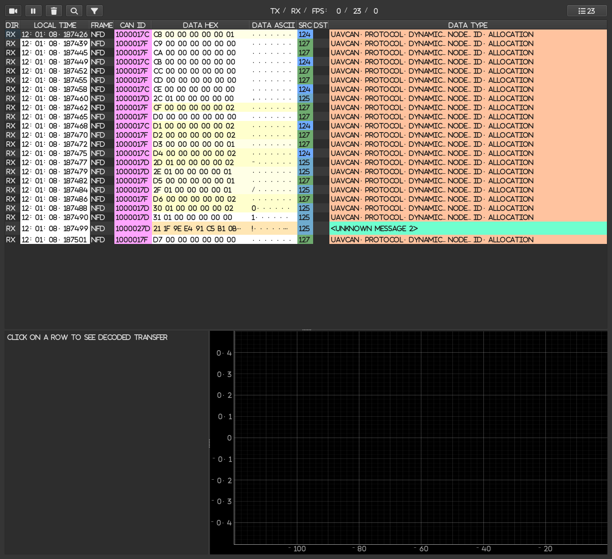
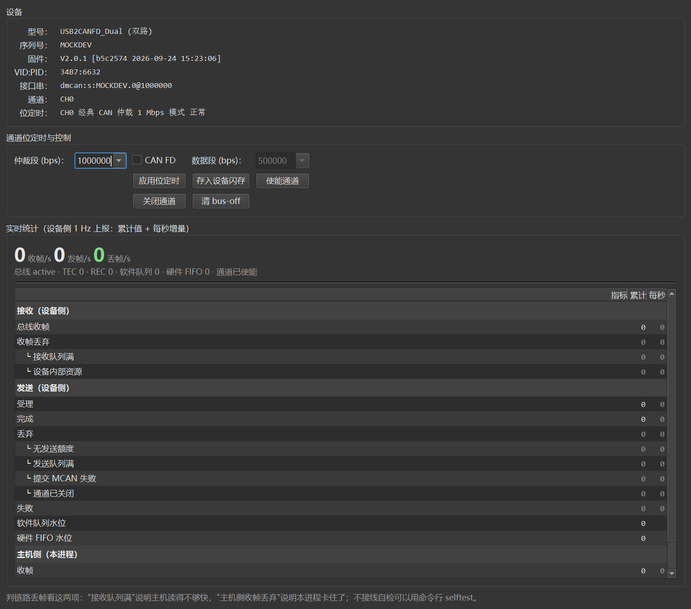

**English** · [简体中文](README.zh-CN.md)

# DroneCAN GUI Tool — DM (达妙) native USB fork

> [DroneCAN GUI Tool](https://github.com/DroneCAN/gui_tool) that talks to **DM USB2CANFD / USB2FDCANDUAL**
> adapters over **native USB** (via the DM Device SDK) instead of the SLCAN "USB serial + ASCII lines" path.
> Zero dropped frames at full bus rate — and it tells you *which stage* dropped them.



## What this fork adds

| | Upstream gui_tool | This fork |
| --- | --- | --- |
| Connecting a DM adapter | SLCAN only (treated as a USB serial port) | **Native USB** (new `dmcan:` interfaces) |
| Loaded bus | Serial baud rate + text parsing become the bottleneck | USB bulk endpoints; 20,000 frames/s injected with zero loss |
| Drop diagnostics | Only "frames are missing" | Device side and host side counted separately, broken down by cause (RX queue full / device resources / no TX credit …) |
| Adapter panel | SLCAN CLI panel | DM panel: identity, bit timing, 1 Hz live statistics, channel enable/disable |
| Dark theme | Table text and icons unreadable on dark backgrounds | Fixed (the light theme stays **bit-for-bit identical** to upstream) |

**Without the DM SDK everything still works**: the interface list simply lacks the `dmcan:` entries,
and SLCAN / socketCAN / PCAN / mcast / mavcan behave exactly as upstream.

## Hardware and platforms

* DM **USB2CANFD / USB2FDCANDUAL** (VID:PID `34B7:6632`); every channel of a dual/quad module is a separate interface;
* Classic CAN and **CAN FD** (`+<data bitrate>` syntax; TDC is enabled automatically above 1 Mbps);
* Windows 10/11 (including the standalone exe) and Linux, including WSL2 (tested on Ubuntu 22.04).

---

## Getting started

### Option A: standalone exe (Windows, no Python needed)

Download `dronecan-gui-tool-dm-v0.1.0-win64.zip` (~105 MB) from
[Releases](https://github.com/CaFeZn/dronecan_gui_tool_dm/releases/latest) and unzip it:

```
dronecan-gui-tool-dm\
├── dronecan-gui-tool-dm.exe   ← double-click this one (GUI)
├── dmcan-dronecan-tool.exe      command line (doctor / list / monitor / selftest)
├── dlls\                        native libraries — **must stay next to the exe**
├── _internal\                   runtime (Python / PyQt6 / libraries)
└── README-使用说明.txt            quick start (Chinese)
```

Copy the whole folder around; if SmartScreen complains on the first run, pick "Run anyway".
To build it yourself (or build a newer version), see
[Building a standalone exe](#building-a-standalone-exe-optional).

### Option B: from source

```bash
git clone https://github.com/CaFeZn/dronecan_gui_tool_dm
cd dronecan_gui_tool_dm

python -m venv .venv
.venv/Scripts/python -m pip install -r requirements.txt    # Linux/macOS: use .venv/bin/python
.venv/Scripts/python -m pip install dmcan_sdk              # DM SDK Python binding
.venv/Scripts/python tools/fetch_dmcan_lib.py              # copy the native library into dlls/
.venv/Scripts/python -m pip install -e .                   # optional: installs the two CLI entries
```

[`tools/fetch_dmcan_lib.py`](tools/fetch_dmcan_lib.py) finds `libdmcan` inside the DM SDK
(`libdmcan.dll` on Windows, `libdmcan.so` on Linux), copies it together with its dependencies into
`dlls/` and prints SHA256 sums. Point it at a non-default SDK checkout with
`--sdk /path/to/dm-device-sdk`, or set `DMCAN_LIBRARY_PATH` to the library file directly.

### Sanity check

```bash
.venv/Scripts/python -m dronecan_gui_tool.dmcan_cli doctor
```

```
平台：Windows AMD64 / Python 3.14.3
dmsdk 可用（libdmcan 2.1.0：...\dlls\libdmcan.dll）
  dmcan_sdk 包版本：2.1.1
设备数：1
  #0  USB2CANFD_Dual (双路)  SN=08BD7F93F24654BCCAB457ACF4C13C29  VID:PID=34B7:6632
结论：环境就绪，可以用 list / monitor / selftest。
```

> The CLI and the adapter panel print in Chinese today; the messages above are shown verbatim.

---

## First connection

1. Plug in the adapter and wire the bus (CANH/CANL, 120 Ω termination at both ends, common ground —
   same as any other CAN device);
2. Start the GUI:

   ```bash
   .venv/Scripts/python -m dronecan_gui_tool.main     # or just `dronecan_gui_tool` after pip install -e .
   ```

   On Windows you can also double-click `run_gui.bat`;
3. In the dialog pick an entry with the **`dmcan:`** prefix and set the bit rate to your bus rate
   (DroneCAN's default is **1 Mbps**);
4. The main window then lists the nodes it sees. To check link quality, see
   [Reading the drop counters](#reading-the-drop-counters).

To skip the dialog:

```bash
dronecan_gui_tool --interface dmcan:0.0@1000000
```

---

## Interface string syntax

```
dmcan:<device>[.<channel>][@<nominal bitrate>][+<data bitrate>]
```

| Part | Meaning |
| --- | --- |
| `<device>` | enumeration index `0`,`1`… or `s:<serial>` (**recommended** — indices change with the USB port) |
| `.<channel>` | 0/1 on a dual module, 0-3 on a quad; defaults to "Bus Number − 1" from the UI |
| `@<bitrate>` | arbitration bit rate in bps; defaults to the UI's "CAN bus bit rate" |
| `+<bitrate>` | data bit rate: **specifying it means CAN FD + BRS**, omitting it means classic CAN |

```bash
dmcan:0                     # CH0 of device 0
dmcan:0.1@500000            # CH1 at 500 kbps
dmcan:s:E4B3230B4E4B.0      # select by serial (recommended)
dmcan:0.0@1000000+5000000   # CAN FD: 1 Mbps arbitration / 5 Mbps data
```

Parsing is strict: a malformed string is an error, it never "guesses a nearby device" — guessing
wrong means transmitting onto somebody else's bus. Trailing free text after the interface string is
ignored (cut at the first whitespace), so pasting straight from the dropdown works.

---

## Command line tools

```bash
dmcan-dronecan-tool <command>          # after pip install -e .
# or: python -m dronecan_gui_tool.dmcan_cli <command>
```

| Command | Purpose |
| --- | --- |
| `doctor` | Environment check: Python / dmcan_sdk / native library / dependency resolution / device enumeration |
| `list` | List devices and usable interface strings (paste straight into the GUI) |
| `info <iface>` | Device identity, firmware version + **build ID**, bit timing details (incl. TDC), statistics breakdown |
| `monitor <iface> [--seconds N]` | **Watch for drops**: one line per second with device-side deltas, host-side drops and bus state |
| `selftest <iface> [--count N] [--rate HZ]` | **External loopback self-test** — no wiring needed, reports loss and round-trip latency |

```bash
$ dmcan-dronecan-tool monitor dmcan:0.0@1000000 --seconds 6
    时间    收帧/s    发帧/s  丢帧(收)  队列/内部  丢帧(发)   主机丢 总线      TEC  REC
    2.2s      61.9       0.0         0        0/0         0        0 active      0    0
    3.2s      62.0       0.0         0        0/0         0        0 active      0    0
===== 汇总（6.1 s）=====
设备侧收帧      ：377（61.9 帧/s）
设备侧收帧丢弃  ：0（其中接收队列满 0 / 设备内部 0）
主机侧收帧丢弃  ：0
结论            ：本段观测内零丢帧。

$ dmcan-dronecan-tool selftest dmcan:0.1@1000000 --count 2000
回环自检：发 2000 收 2000 丢 0（0.000%）

$ dmcan-dronecan-tool selftest dmcan:0.1@1000000 --count 1000 --rate 500
回环自检：发 1000 收 1000 丢 0（0.000%）；往返延迟 min/p50/平均/最大 = 1.22/1.61/1.62/2.18 ms
```

> `selftest` temporarily switches the channel to external loopback: the frames **do** drive the bus
> (they just don't wait for ACKs), so don't run it while other nodes are online. The previous mode is
> restored afterwards. To validate a real two-node link, run `selftest --keep-mode` on one module and
> `monitor` on the other.

---

## The three windows

* **Main window** — node list, service calls, parameter access, firmware update; unchanged from upstream;
* **Tools → Bus Monitor** — per-frame view, `Data Hex` / `Data ASCII` coloured by transfer ID, bus load plot;
* **Tools → CAN Adapter Control Panel** — the new DM adapter panel:

  * device identity: model / serial / VID:PID / firmware version + build ID / channel configuration;
  * bit timing: arbitration and CAN FD data phase — "Apply" takes effect immediately, "Save to flash" persists;
  * **1 Hz live statistics**: device-side totals and per-second deltas, RX/TX drops broken down by cause,
    plus host-side drops and TX queue depth;
  * enable / disable channels, clear bus-off.



### Reading the drop counters

Drops can only appear in four places, each with a distinct meaning:

| Counter | What it means |
| --- | --- |
| Device `RX dropped · queue full` | The host isn't draining fast enough — a host-side problem (GUI stalling, heavy work in the callback) |
| Device `RX dropped · internal resources` | The device itself can't keep up — the bus is saturated |
| Device `TX dropped` | Cannot transmit: bus full / no TX credit / MCAN queue full |
| Host `RX dropped` | This process's queue overflowed; only happens when the GUI is frozen for a while |

---

## Appearance: follow system / dark / light

**View → Appearance**: `Follow System` (default), `Dark`, `Light`. The choice is remembered and
applies to the next launch as well as to the Bus Monitor and Plotter windows (separate processes).
Switching takes effect immediately (the icons are re-tinted).

Override it for a single run (handy for shortcuts; not written back to the preference):

```bash
dronecan-gui-tool-dm.exe --interface dmcan:0.0@1000000 --appearance light
```

---

## FAQ / troubleshooting

| Symptom | Cause and fix |
| --- | --- |
| No `dmcan:` entries in the interface list | Run `doctor` first: usually `dmcan_sdk` is missing or `libdmcan` wasn't found (the message says which) |
| `libdmcan failed to load: OSError [WinError 127] The specified procedure could not be found` | A same-named DLL on `PATH` shadowed the dependency. Machines with ST-Link / QEMU / MSYS2 / OpenOCD / STM32CubeCLT often carry their own `libstdc++-6.dll` and `libusb-1.0.dll`. **Fixed here**: the dependencies in `dlls/` are preloaded by absolute path. If it still fails, `doctor` prints which copy was resolved |
| `Failed to open device … already in use` | A serial terminal or another GUI instance holds it; the tool retries 3 times, then close the other owner |
| `Failed to enable channel` | Firmware too old: enabling/disabling a channel requires the 2-byte response — **V2.0.0 or newer** (see `info` for the version and build ID) |
| Device not found by serial | The serial occasionally reads back empty (right after another process released the USB handle). The tool refreshes and retries once; if it still fails, use the index (`dmcan:0.1`) |
| Want both channels at once | `open()` is a USB session for the **whole device**, shared by both channels; one session per process — the tool says so explicitly |
| Cannot open the device on Linux | No write access to `/dev/bus/usb/*/*`: add a udev rule (`SUBSYSTEM=="usb", ATTR{idVendor}=="34b7", MODE="0666"`) or run as root |
| No frames at all | Run `selftest` first (loopback, no wiring) to prove the link itself works; then check bit rate / sample point on both ends, termination, classic vs FD, and whether the channel is enabled |
| Bus load too high | Upstream's `--filtered` (low-bandwidth filtering) is **deliberately not implemented** for the dmcan backend: USB has bandwidth to spare, and DroneCAN needs every frame (dynamic node ID allocation, param/file services, anonymous frames) |
| How do I know whether frames are dropped? | **Tools → CAN Adapter Control Panel** (device-side and host-side counters), or `monitor` on the command line |
| Double-clicking the exe does nothing | Check `dronecan-gui-tool-crash.log` next to the exe — windowed mode has no console, and startup exceptions land there |
| `run_gui.bat` does nothing in PowerShell | Use `.\run_gui.bat dmcan:0.0` (PowerShell does not execute from the current directory), and never `python run_gui.bat` |

---

## Measurements

**Why not SLCAN**: SLCAN encodes every CAN frame as an ASCII line (`t1238AABBCCDD\r`) over USB-UART,
which brings three structural bottlenecks:

| Stage | SLCAN | This fork (dmcan) |
| --- | --- | --- |
| Transport | USB-UART bridge, limited by the serial baud rate | USB bulk endpoints, no host-side baud limit |
| Framing | ~2× inflated ASCII plus line separators | Binary 84-byte structs (timestamp / channel / flags included) |
| Host processing | Byte-by-byte text parsing, `\r` splitting | SDK notify-thread callback, frames already sliced, queued directly |
| Drop visibility | Only "not received" | Device-side / host-side split, broken down by cause |

The DM SDK ships its own baseline (`docs/perf/PERFORMANCE_BASELINE.md`): single module external
loopback **25.8k frames/s, 0 drops**; two modules, one direction, **100k frames at 26.4k frames/s,
0 drops**; host CPU **0.78 µs/frame**. SLCAN on the same hardware is one to two orders of magnitude
worse, and starts dropping as soon as the bus gets busy.

**Does the GUI drop frames?** (real USB2CANFD_Dual, CH1 external loopback, classic CAN 1 Mbps)

| Injected rate | Sent | Decoded | Device-side drops | Host-side drops | RX queue peak |
| --- | --- | --- | --- | --- | --- |
| 1,000 fps | 4,844 | 4,849 | 0 | 0 | 20 |
| 5,000 fps | 24,999 | 25,004 | 0 | 0 | 110 |
| 10,000 fps | 50,085 | 49,711 | 0 (17 in one run) | 0 | 155 |
| 20,000 fps | 76,428 | 76,440 | 0 | 0 | 181 |
| 10,000 fps + Bus Monitor + adapter panel | 39,619 | 39,625 | 0 | 0 | 149 |

Even with a 1 Mbps classic CAN bus pushed close to saturation (physical limit ≈ 9,000 fps), the host
RX queue never exceeds ~200 frames out of 131,072. Above 10,000 fps the device occasionally drops
frames because **the bus is full** — the tell is that `queue full` stays at 0, i.e. the host was
never the bottleneck.

---

## Linux / WSL

The same code runs on Linux (it looks for `libdmcan.dll` on Windows and `libdmcan.so` on Linux).
Tested on WSL2 / Ubuntu 22.04, passing the adapter through with
[usbipd-win](https://github.com/dorssel/usbipd-win):

```powershell
usbipd list                                    # find the BUSID of the 34b7:6632 line
usbipd bind --busid 4-1 --force
usbipd attach --wsl --busid 4-1
```

```bash
wsl -d Ubuntu -e bash -c "lsusb | grep 34b7"    # confirm the device is visible inside WSL
```

Before running anything under WSL, sync the source into the Linux filesystem with the bundled script
(much faster than running from `/mnt/d`, and it avoids cross-filesystem permission/encoding quirks),
then run the whole smoke suite:

```powershell
.\tools\wsl_sync.ps1
wsl -d Ubuntu -u root -e bash -c "cd /home/dm/dgt && bash tools/linux_smoke.sh"
```

Measured (same adapter, CH1 external loopback):

| Item | Result |
| --- | --- |
| `doctor` | `dmsdk available (libdmcan 2.1.0: …/dlls/libdmcan.so)`, device enumerated |
| Loopback self-test | sent 500, received 500, **0 lost**; round-trip p50 **33.4 ms** (1.67 ms on Windows — the gap is USB/IP + WSL virtualisation) |
| Monitoring CH1 | zero device-side and host-side drops |
| GUI | full path works: `dmcan session ready` → `Init complete` → nodes on the bus discovered |
| Unit tests | 87 pass (2 Windows-only cases skipped) |
| Upstream **SLCAN** backend (USB serial) | works as well — 30 frames in 10 s |

> After testing, run `usbipd detach --busid 4-1` **and then `usbipd unbind --busid 4-1`**:
> detaching alone leaves the device bound to the usbipd driver and the Windows GUI won't see it.

---

## Building a standalone exe (optional)

```bash
python -m pip install pyinstaller
python tools/build_exe.py          # output in dist/dronecan-gui-tool-dm/
```

The GUI and CLI executables share one runtime; the folder is ~224 MB and can be copied anywhere.
The build script already handles a few non-obvious things (each commented where it matters):

* pydronecan's **DSDL data files** (`dronecan/dsdl_specs/**/*.uavcan`) must be bundled, otherwise no message type gets registered;
* `dmcan` is a function-level optional import, so it needs an explicit `hiddenimports` entry;
* runtime-irrelevant `*.dist-info` metadata is not bundled: `python-can` scans `entry_points.txt` on import and crashes if such a file reads back as invalid UTF-8 — which in windowed mode looks like "double-click does nothing";
* windowed mode has no console, so startup exceptions are written to `dronecan-gui-tool-crash.log` next to the exe;
* `multiprocessing.freeze_support()` must come first (Bus Monitor / Plotter spawn child processes).

---

## For developers

> **How the integration works**: [docs/porting-dmsdk.md](docs/porting-dmsdk.md) — layering, how the
> optional dependency is kept optional, the RX path and SDK timing rules, the exact upstream touch
> points, the pitfalls we hit, and an 8-step recipe for integrating a different CAN adapter.

```
dronecan_gui_tool/
├── driver/                      ★ new: the dmcan backend
│   ├── dmsdk.py                 the only optional-dependency entry point (probe / load / library lookup / SDK log level)
│   ├── dmcan_iface.py           interface string syntax, device enumeration
│   ├── dmcan_session.py         session: open / bit timing / enable / statistics / self-test (no pydronecan)
│   ├── dmcan_driver.py          pydronecan glue (AbstractDriver)
│   └── __init__.py              make_node dispatch + interface listing
├── dmcan_cli.py                 ★ headless CLI
├── widgets/dmcan_control_panel/ ★ adapter control panel
├── widgets/theme.py             ★ dark/light theme adaptation
├── main.py                      ✎ two changes: make_node dispatch, panel selection
└── setup_window.py              ✎ one change: append dmcan entries to the interface list
```

`DmCanSession` does not depend on pydronecan at all: the GUI driver, the CLI and the self-test share one
implementation of "how to configure the device and read its statistics". `DmCanDriver` only converts
frames and queues them. **"dmsdk is optional"** works because `driver/dmsdk.py` is the only module that
imports `dmcan` (inside a function) and because the interface-list append is wrapped in try/except.

```bash
python -m unittest discover -s tests -t .     # 87 cases, no hardware required
python tests/gui_smoke.py --mock              # offscreen GUI smoke test (fake SDK, screenshots + panel dump)
python tests/gui_stress.py --rates 10000 --seconds 6 --monitor --panel   # stress test (needs hardware)
```

`tests/fake_dmcan.py` implements the public dmcan_sdk API (same class, method and return semantics),
replacing USB with an in-process virtual bus and injecting faults ("device unplugged", "open failed",
"serial read empty"), so the driver is tested while believing it is talking to the real SDK.

---

## Relationship to upstream

* Based on [DroneCAN/gui_tool](https://github.com/DroneCAN/gui_tool) (MIT); all of its features and backends are preserved;
* New code lives in `driver/dmsdk.py`, `driver/dmcan_*.py`, `dmcan_cli.py`,
  `widgets/dmcan_control_panel/` and `widgets/theme.py`; upstream files are touched only in
  `main.py` (two dispatch points) and `setup_window.py` (one interface-list append);
* The native library and trademarks belong to DM; fetch it from the official
  [DM-Device-SDK](https://gitee.com/kit-miao/dm-device-sdk). This repository does not ship it;
* Licence and credits: [LICENSE](LICENSE) and [NOTICE.md](NOTICE.md).
